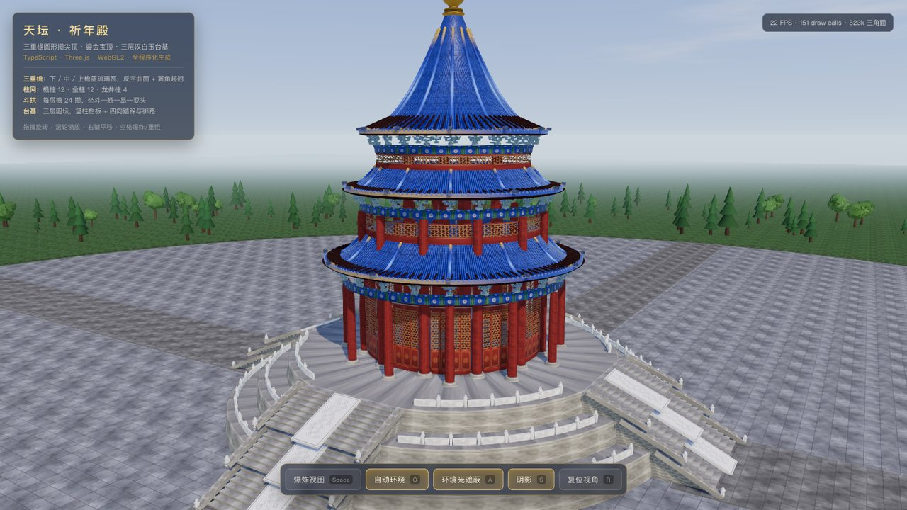
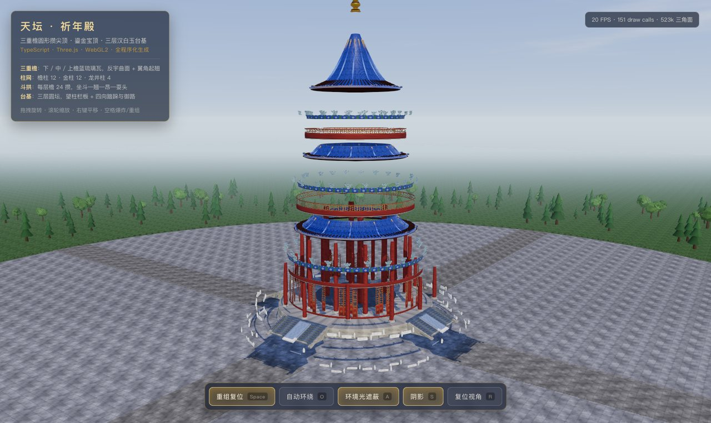
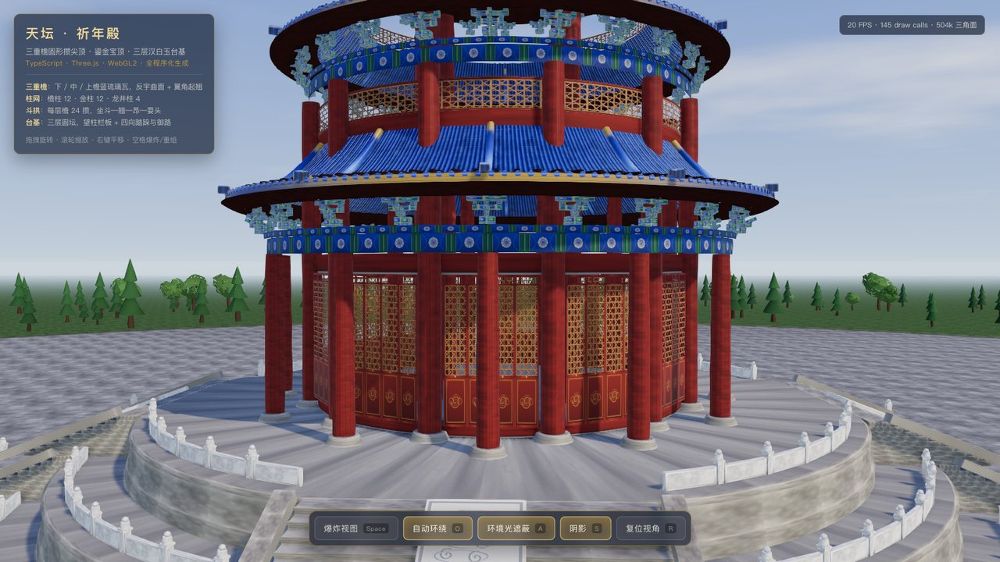
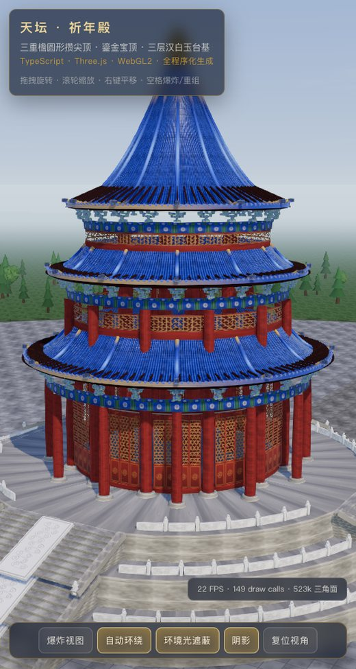

# 天坛 · 祈年殿 — TypeScript + Three.js 全程序化生成（DeepSeek-Flash）

> 项目名称：**祈年殿 / Temple of Heaven** · 本次模型：**DeepSeek-Flash**
> 仓库：`temple-of-heaven-deepseek-flash`

**在线演示（GitHub Pages）：<https://bill-666code.github.io/temple-of-heaven-deepseek-flash/>**

一个**完整可运行**的 WebGL 项目：北京天坛祈年殿的三重檐圆形攒尖顶建筑，
**所有几何体、贴图、动画均由代码在运行时程序化生成**——
项目中没有任何 `.glb / .gltf / .obj / .fbx` 模型文件，也没有任何图片资源，
连天空、云、树木、汉白玉纹理、琉璃瓦、彩画、格心门窗全部由 Canvas2D 与数学曲线现场绘制。



| 正常展示 | 爆炸视图 |
| --- | --- |
|  |  |

| 近景（门窗 / 斗拱 / 彩画） | 竖屏自适应 |
| --- | --- |
|  |  |

---

## 一、快速开始

环境要求：**Node.js ≥ 18**（开发时使用 Node 22.22 / npm 10.9 验证），支持 WebGL2 的现代桌面浏览器。

```bash
cd temple-of-heaven

# 1. 安装依赖（three / vite / typescript，约 20 个包）
npm install

# 2. 开发模式（默认 http://localhost:5173/ ，带 HMR）
npm run dev

# 3. 生产构建（先 tsc 类型检查，再 vite 打包到 dist/）
npm run build

# 4. 预览构建产物（默认 http://localhost:4173/ ）
npm run preview

# 仅做类型检查
npm run typecheck
```

> 首次打开会有约 1–3 秒的"程序化生成"过程（绘制全部贴图 + 生成几何 + 烘焙环境光照），
> 页面有进度条提示；生成完成后不再有额外加载。

### 部署到 GitHub Pages

仓库内已包含 `.github/workflows/deploy-pages.yml`：推送到 `main` 分支后自动执行
`npm ci → npm run build → 上传 dist → 发布 Pages`。
`vite.config.ts` 中 `base: './'` 使用相对路径，因此发布在 `https://<用户>.github.io/<仓库名>/`
子路径下也能正确加载资源（无需为此改动任何代码）。

### 操作方式

| 操作 | 说明 |
| --- | --- |
| 左键拖拽 | 旋转（OrbitControls，带阻尼） |
| 滚轮 / 双指捏合 | 缩放（22m ~ 460m） |
| 右键拖拽 | 平移 |
| 按钮「爆炸视图 / 重组复位」 | 构件按层次错峰散开 / 精确复位（快捷键 `Space`） |
| 按钮「自动环绕」 | 缓慢自动环绕展示，帧率无关（`O`） |
| 按钮「环境光遮蔽」 | GTAO 开关（`A`） |
| 按钮「阴影」 | 阴影开关（`S`） |
| 按钮「复位视角」 | 相机与构件一起复位（`R`） |

---

## 二、目录结构

```
temple-of-heaven/
├── index.html                 # 页面骨架（画布 / 标题卡 / 载入遮罩 / 按钮容器）
├── vite.config.ts
├── tsconfig.json              # strict + noUnusedLocals，构建前强制类型检查
└── src/
    ├── main.ts                # 启动流程：材质 → 渲染管线 → 环境 → 建筑 → 交互 → 主循环
    ├── config.ts              # ★ 建筑比例总控（唯一的尺寸数据源，改这里即可改造型）
    ├── styles.css             # 界面样式（靛蓝 / 朱红 / 鎏金配色）
    ├── procgen/               # ── 程序化生成基础库 ──
    │   ├── random.ts          # 确定性 PRNG（同种子 → 同结果）
    │   ├── canvas.ts          # 画布、噪声、Sobel 高度→法线烘焙
    │   ├── textures.ts        # 22 张程序化贴图（琉璃瓦/彩画/汉白玉/格心/铺装/草地…）
    │   ├── profile.ts         # 中国式"反宇"屋面曲线（起翘 / 出翘）
    │   └── geometry.ts        # 旋转体、瓦垄棱纹、合并、实例化、环向排布
    ├── building/              # ── 建筑构件 ──
    │   ├── Materials.ts       # 共享材质库（21 种材质，单例复用）
    │   ├── Platform.ts        # 三层汉白玉台基 + 望柱栏板 + 踏跺 + 御路
    │   ├── Columns.ts         # 檐柱 12 / 金柱 12 / 龙井柱 4 + 柱础 + 室内金砖地
    │   ├── Openings.ts        # 48 扇隔扇门 + 槛窗 + 鼓身墙体
    │   ├── Dougong.ts         # 额枋彩画 + 平板枋 + 参数化斗拱（坐斗→翘→昂→耍头）
    │   ├── Roof.ts            # 三重檐屋面（瓦面/椽望/瓦口/瓦当/椽子/垂脊）
    │   ├── Finial.ts          # 鎏金宝顶（控制点插值旋转体）
    │   └── Hall.ts            # 装配 + 爆炸层次定义（42 个可动构件）
    ├── core/
    │   ├── SceneEnv.ts        # 天空 shader / PMREM 环境贴图 / 地面 / 绿化 / 光照 / 雾
    │   ├── Renderer.ts        # 渲染管线（GTAO + ACES + SMAA），按需刷新阴影
    │   └── CameraRig.ts       # OrbitControls + 自动环绕 + 爆炸联动推拉
    ├── animation/
    │   └── ExplodeController.ts  # 爆炸/重组：三种位移模式 + 错峰 + 可打断 + 精确复位
    └── ui/
        └── Hud.ts             # 按钮、统计、进度条、轻提示
```

---

## 三、建筑还原

尺寸取自祈年殿实物比例（殿身直径约 24.2m、殿高约 38.2m、下有三层圆形台基），
全部集中在 `src/config.ts`（单位：米，`hallRoot` 局部原点 = 台基顶面）：

| 部位 | 关键尺寸 |
| --- | --- |
| 台基 | 三层圆形，半径 18.0 / 21.2 / 24.4，每层高 2.0 / 2.2 / 2.4，合计 6.6m |
| 柱网 | 檐柱 12（r=12.0，高 7.8）· 金柱 12（r=9.95，高 15.6）· 龙井柱 4（r=4.9，高 21.9） |
| 下檐 | 檐口 r=13.7 @ y=10.2，收至 r=9.35 @ y=13.4，外挑 1.7m |
| 中檐 | 檐口 r=11.45 @ y=17.8，收至 r=8.05 @ y=20.4 |
| 上檐 | 檐口 r=9.7 @ y=23.6，连续凹曲面直通攒尖顶 r=0.95 @ y=35.5 |
| 宝顶 | 鎏金，高 3.7m，最大宝珠半径 1.12m |
| 瓦作 | 筒瓦垄距 0.46m，每重檐 132~188 垄（几何棱纹与贴图垄距严格对齐） |

**"不能是简单圆锥"**：屋面剖面由 `buildRoofProfile()` 生成——
半径线性、高度取 `t^curve`（curve≈1.85）形成"近脊陡、近檐缓"的反宇曲面，
再叠加二次衰减的**起翘**（檐口末端上翘 0.34~0.42m）与**出翘**（檐口向外甩出 0.24~0.30m），
得到"如翚斯飞"的翼角；屋面另生成沿法向内缩的下表面（椽望板），檐下不透空。

---

## 四、程序化生成的技术要点

- **贴图**：`Canvas2D` 绘制 + 确定性 PRNG（同种子同结果）。琉璃瓦、栏板云纹、御路石雕额外用
  Sobel 从灰度高度图烘焙**切线空间法线贴图**，因此瓦垄、浮雕在光照下有真实凹凸。
- **几何棱纹**：`addTileRipple()` 按 UV 相位沿径向起伏，波峰严格落在贴图每条瓦垄中心，
  再让顶部收束处自然淡出——既有体积感又不会在攒尖处扭曲。
- **斗拱**：`bracketGeometry(reach, height, width)` 参数化生成坐斗/翘/横拱/三才升/昂/耍头，
  每层檐按出挑尺寸各生成一套，24 攒沿柱网排布（柱头科对齐柱位）；每个小构件的 UV
  随机取样彩画贴图不同区域，避免"千篇一律的平色"。
- **实例化**：全场景 25 个 `InstancedMesh` / 1500 个实例——瓦当（每重檐数百枚）、椽子、
  望柱、栏板、斗拱、隔扇门、柱列、树木（含树干/树冠顶点色与逐株色彩抖动）。
  静态构件（踏步、垂带、御路、垂脊、门窗墙带）先合并再提交，场景共 72 个网格。
- **环境光照**：天空是自定义 shader（天顶—地平线渐变 + fbm 层积云 + 日面与大气辉光），
  同一材质再经 `PMREMGenerator.fromScene()` 烘焙成环境贴图，为琉璃瓦与鎏金提供真实反射。
- **后处理**：`RenderPass → GTAOPass（半分辨率 + Poisson 去噪）→ OutputPass（ACES + sRGB）→ SMAAPass`。
  计算 AO 的 G-Buffer 时自动临时隐藏天空球。

## 五、性能取舍

- 阴影贴图 **按需刷新**：`shadowMap.autoUpdate = false`，只有爆炸动画进行中或首帧才重算。
- 像素比上限 1.75；AO 以 0.6 倍分辨率计算；`three` 单独分包（gzip 后约 126KB + 应用 75KB）。
- 实测（软件渲染 SwiftShader，1440×860，AO+阴影全开）：约 20–23 FPS、214 draw call、
  每帧 78 万三角面；**真实 GPU 上会显著更高，但本项目未在真实 GPU 上做过帧率实测**（见下节）。
- 若在低端设备上偏慢：点掉「环境光遮蔽」按钮收益最大（AO 需要额外一遍全场景 G-Buffer）。

---

## 六、验证情况（如实说明）

**已实际验证**（用无头 Chrome 加载真实构建产物，脚本：加载 → 截图 → 断言 → 读取运行时状态）：

| 项目 | 结果 |
| --- | --- |
| `npm install` / `tsc --noEmit` / `vite build` | ✅ 通过（dist 约 179KB 应用代码 + 501KB three，gzip 75KB + 126KB） |
| `npm run dev` 与 `npm run preview` | ✅ 均能加载并完成渲染，无控制台报错/警告 |
| 场景规模 | ✅ 72 网格 / 25 InstancedMesh / 1500 实例 / 26.3 万三角面（场景本身） |
| 爆炸动画 | ✅ 展开度到达 1.0 并 settled；按钮文案切换为「重组复位」 |
| **重组精确复位** | ✅ 逐个比对 9 个构件组的 position/scale、门扇实例矩阵、望柱实例矩阵，**最大偏差 = 0** |
| 自动环绕 | ✅ 4 秒内相机位移 1.0（修正了原先未传 deltaTime 导致的帧率相关 bug） |
| AO / 阴影开关 | ✅ 状态与渲染管线同步切换 |
| 响应式 | ✅ 480×900 竖屏下画布重设、相机 aspect 更新、按钮栏自适应、图例自动隐藏 |
| 几何合并 | ✅ 修复了 `IcosahedronGeometry`（无索引）与索引几何体混合合并失败的问题 |
| 台基标高 | ✅ 修复了台基 world/local 坐标混用导致整体抬高 6.6m、埋住殿身门窗的问题 |

**未验证 / 已知限制**：

1. **未在真实 GPU（独显/苹果芯片）上实测帧率**——本机验证走的是无头 Chrome + SwiftShader 软件渲染，
   FPS 数字不代表真机；请以打开页面后右上角统计为准。
2. **未在移动端 Safari / 触屏设备上实测**（响应式布局与指针事件已按规范处理，但未真机验证）。
3. 建筑造型为**程序化写意还原**：斗拱做了简化（一跳单昂、24 攒），
   屋面瓦垄数、彩画纹样并非实物测绘；祈年殿实物的 28 根柱、三重檐比例、圆形攒尖顶等
   关键特征均按公开资料取比例近似。
4. 门槛/走马板等细节为整圈圆柱面，近距离贴脸观察会看到重复感。

---

## 七、扩展指引

- **改造型**：只改 `src/config.ts`。`EAVES[]` 控制三重檐的半径、标高、曲线幂次、起翘量、
  斗拱出挑与攒数；`COLUMNS`/`PLATFORM`/`TILE` 同理。几何与实例数会自动跟随（含瓦垄数取整对齐）。
- **加构件**：在 `src/building/` 下新增模块，返回一个 `Group`，在 `Hall.ts` 中 `root.add()`
  并追加一条 `ExplodeSpec`（三种模式：`translate` / `radialScale` / `instanced`）。
- **换贴图**：`src/procgen/textures.ts` 里每个函数都是独立可替换的 Canvas 绘制过程，
  带 `memo` 缓存；改完直接热更新。
- **调试钩子**：页面控制台可用 `__QND__` 访问 `{ scene, rig, pipeline, explode, hall, env, mats }`。
- **降级路径**：`pipeline.setAO(false)` / `setShadows(false)` 可运行时关闭重负载特效；
  阴影、AO、SMAA 三个 Pass 均可单独移除（`src/core/Renderer.ts`）。

---

## 附录：本项目的生成提示词

> 以下为生成该项目的原始提示词（Prompt），原文照录，未作改写。

```text
请用 TypeScript + Three.js 创建完整可运行的北京天坛祈年殿 WebGL 项目。所有建筑几何、纹理和动画必须由代码在运行时程序化生成，禁止加载 .glb、.gltf、.obj、.fbx 等外部模型。

建筑还原：
三层不同尺寸与高度的蓝色琉璃瓦圆顶、鎏金宝顶、红色圆柱、圆形殿身、蓝绿金色彩绘、斗拱及门窗。
屋顶使用曲线轮廓、旋转体或自定义几何，表现舒展、微翘的屋檐，不能用简单圆锥代替。
白色汉白玉三层圆形台基，配中央石阶、栏杆和立柱；整体比例协调、层次清晰。
程序化生成瓦片纹理和装饰，重复构件优先使用 InstancedMesh。

场景与交互：
北京蓝天、广场地面与少量绿化；使用 DirectionalLight 搭配 AmbientLight／HemisphereLight，开启阴影、环境遮蔽和适度电影色调映射。
支持 OrbitControls 旋转、缩放，以及可开关的缓慢自动环绕展示。
按钮切换“爆炸／重组”：屋顶、柱子、斗拱、墙体、门窗、栏杆和台基按层次平滑散开，再准确恢复原位。动画须由代码驱动，有错峰节奏，避免瞬移。

直接交付完整项目及启动说明。页面应响应式适配窗口，具备高质量视觉效果和流畅交互，并通过实例化、合理几何细节及渲染优化兼顾普通桌面浏览器性能。代码模块清晰，方便扩展；验证构建与主要功能，如实说明未验证项。
```

## 八、许可与素材

本项目不含任何第三方模型、图片或字体文件；`three` 通过 npm 依赖引入，遵循其 MIT 许可。
建筑形制参考公开资料，仅供学习与展示使用。

- 仓库：<https://github.com/Bill-666code/temple-of-heaven-deepseek-flash>
- 在线演示：<https://bill-666code.github.io/temple-of-heaven-deepseek-flash/>
